# Implementing GPT-2 from Scratch: A Small Decoder-Only Transformer for Story Generation

## Abstract
I implemented a GPT-2-style decoder-only Transformer from scratch in PyTorch (token and positional embeddings, causal
multi-head self-attention, feed-forward networks, layer normalization, residual connections, Transformer blocks, a
training pipeline, and autoregressive sampling) and trained a 12.3M-parameter model on TinyStories with a byte-level BPE
tokenizer of 4,096 tokens. After seeing 262M training tokens the model reaches a validation loss of 1.372 nats per token
(perplexity about 3.9) and writes grammatical, locally coherent children's stories, with remaining failures in
long-range logic. Experiments show that (i) a 12M-parameter model clearly overfits a 0.4M-token corpus (Tiny Shakespeare),
while its TinyStories run shows no widening train-validation gap; (ii) sampling temperature trades diversity against
repetition and coherence; (iii) loss on fixed target tokens
falls steadily with context length, with about 87% of the gain obtained from the first 32 tokens; (iv) one attention head
was 0.017 nats worse than six in these runs at equal parameter count, while six and twelve heads were effectively tied and
twelve heads had lower throughput; and (v) the post-LayerNorm run stalled at the learning rate where pre-LayerNorm trained
well and remained substantially worse at a gentler setting.

## 1. Introduction and setup
The goal of this project was to understand the Transformer by building the architecture myself and then testing how it
behaves. The model follows GPT-2 but is much smaller so that it can be trained within a Kaggle GPU budget.

| | |
|---|---|
| Layers / heads / width | 6 / 6 / 384 (head size 64) |
| Context length | 256 tokens |
| Vocabulary | 4,096 (byte-level BPE) |
| Parameters | 12,318,720 (output head tied to the token embedding) |
| Positions | learned absolute embeddings |
| Normalization | pre-LayerNorm, plus a final LayerNorm |
| Activation | GELU (tanh approximation) |
| Training tokens (main run) | 262.1M (8,000 steps of 32,768 tokens) |

**Data.** The main dataset is TinyStories V2 (GPT-4-generated short stories for young children), chosen because very
small models can learn to write coherent English on it. Tiny Shakespeare (about 1.1M characters, 404,778 training tokens
and 46,915 validation tokens with my tokenizer) was used for fast debugging and for an overfitting demonstration. The
TinyStories validation file has 5,578,051 tokens.

**What is from scratch.** All model components, the training loop (including the learning-rate schedule and optimizer
parameter groups), checkpointing, sampling, and the evaluation metrics are my own code. PyTorch provides tensors,
autograd, `AdamW`, and the basic layers `nn.Linear`, `nn.Embedding`, `nn.Dropout`, and `nn.GELU`. LayerNorm and attention
are implemented by hand; PyTorch's `nn.LayerNorm` and `F.scaled_dot_product_attention` are used only inside unit tests as
reference implementations. The Hugging Face `tokenizers` library trains and applies the BPE tokenizer, and
`huggingface_hub` downloads the dataset; no pretrained model or Hugging Face model code is used.

**Compute.** All runs used a single Kaggle GPU with fp16 mixed precision, at about 69k tokens per second for the main
configuration (the main run took about one hour).

The report follows the assignment: Part A explains the original paper, Part B relates it to GPT-2, Part C explains my
implementation, and Part D presents the experiments.

---

# Part A: Understanding "Attention Is All You Need"

## 2.1 The problem the Transformer was designed to address
Before 2017, the dominant sequence-transduction models (machine translation in particular) were recurrent neural
networks such as LSTMs and GRUs, usually with an attention mechanism added on top. A recurrent network reads a sequence
one token at a time and summarizes everything it has seen in a fixed-size hidden state, $h_t = f(h_{t-1}, x_t)$. This
creates two problems:

1. **Sequential computation.** $h_t$ cannot be computed before $h_{t-1}$, so the positions of one sequence cannot be
   processed in parallel during training. This becomes limiting for long sequences, where memory also restricts how many
   examples can be batched.
2. **Long-range dependencies.** For token $j$ to be influenced by token $i$, information must pass through $|i-j|$
   recurrent steps, and signals tend to fade along such long paths.

The paper's contribution was to show that attention alone, without recurrence or convolution, is enough to build a
strong sequence model that is also much faster to train in parallel. It achieved 28.4 BLEU on WMT 2014 English-to-German
translation, the best result at the time.

## 2.2 How the Transformer differs from RNNs and LSTMs
The paper compares layer types in its Table 1 ($n$ is the sequence length, $d$ the representation size, $k$ the
convolution kernel width):

| Layer type | Complexity per layer | Sequential operations | Maximum path length between two positions |
|---|---|---|---|
| Self-attention | $O(n^2 \cdot d)$ | $O(1)$ | $O(1)$ |
| Recurrent | $O(n \cdot d^2)$ | $O(n)$ | $O(n)$ |
| Convolutional | $O(k \cdot n \cdot d^2)$ | $O(1)$ | $O(\log_k n)$ |

- **Parallelism.** Self-attention relates all positions in one matrix multiplication, so all positions are processed at
  once; a recurrent layer needs $n$ sequential steps.
- **Path length.** Any two tokens interact directly in one attention step, rather than through a chain of states. LSTM
  gating eases vanishing gradients but does not change the $O(n)$ path length.
- **Cost.** Attention is cheaper than recurrence when $n < d$. For my model ($n = 256$, $d = 384$), $n^2 d \approx 25$M
  versus $n d^2 \approx 38$M. Its price is memory and compute that grow quadratically with sequence length; my
  implementation materializes a $(B, h, T, T)$ score tensor, which also showed up as a throughput cost in the head-count
  experiment (Section 5.6).
- **Order.** A recurrent network has order built in; attention does not, so the Transformer needs explicit positional
  information (Section 2.5).
- **Generation is still sequential.** The parallelism benefit applies to training and to scoring a known sequence. When
  generating, a Transformer must still produce one token at a time, because each new token depends on the previous one.

## 2.3 Scaled dot-product attention
Each token's vector is projected into three roles: a **query** ("what am I looking for?"), a **key** ("what do I offer?"),
and a **value** ("what do I pass on if I am selected?"). For an input $X \in \mathbb{R}^{T \times C}$ and learned matrices
$W^Q, W^K, W^V$, the paper's Equation 1 is

$$\mathrm{Attention}(Q,K,V)=\mathrm{softmax}\left(\frac{QK^{\top}}{\sqrt{d_k}}\right)V, \qquad Q = XW^Q,\; K = XW^K,\; V = XW^V .$$

For one head and one sequence the shapes are $Q, K \in \mathbb{R}^{T \times d_k}$ and $V \in \mathbb{R}^{T \times d_v}$.
The product $QK^{\top}$ is a $T \times T$ score matrix whose entry $(i, j)$ says how well query $i$ matches key $j$. A row-wise
softmax turns each row into weights that sum to 1, and multiplying by $V$ gives each token a weighted average of the value
vectors. With a batch and several heads there are two more leading dimensions (Section 4.3).

**Why divide by $\sqrt{d_k}$.** If query and key components are independent with zero mean and unit variance, their dot
product has variance $d_k$. Scores therefore grow with the head size, pushing the softmax toward a nearly one-hot
distribution whose gradients are tiny. In the seeded demo with 10,000 random pairs and $d_k = 64$, the variance of
$q \cdot k$ is 64.03 without scaling and 1.0005 after division by $\sqrt{64}$; the notebook also shows a softmax over
typical scores becoming saturated when they are 8× larger.

**What the weights look like.** Unit tests verify the structural properties directly: for a causal attention matrix,
row 0 assigns all its weight to the first token, every entry above the diagonal is exactly 0, and every row sums to 1.
The trained checkpoint develops more structured and peaked patterns; Section 3.3 visualizes three heads from its first
and last layers.

## 2.4 Why attention is divided into multiple heads
A single attention operation produces one weighting of the context per token, so it must average everything the token
needs, such as the previous word, a matching subject, or the clause boundary, into one distribution. Multi-head attention
runs $h$ attentions in parallel, each in its own learned subspace:

$$\mathrm{head}_i = \mathrm{Attention}(XW_i^Q, XW_i^K, XW_i^V), \qquad
\mathrm{MultiHead}(X) = \mathrm{Concat}(\mathrm{head}_1,\dots,\mathrm{head}_h)\,W^O .$$

With $d_k = d_v = d_{model}/h$ the total cost is about that of one full-width head, so more heads add expressiveness
without adding much computation: different heads can attend to different positions or relations at the same time. In my
model $d_{model} = 384$ and $h = 6$, so each head works with 64 dimensions. The $h$ per-head projection matrices are
stored as one $384 \times 384$ matrix for each of Q, K and V, whose output is reshaped into 6 chunks of 64, which is
mathematically identical to six separate $384 \times 64$ matrices. Section 5.6 tests the effect of the number of heads.

## 2.5 Positional encodings
Self-attention without positional information is permutation-equivariant: permuting the input tokens merely permutes the
outputs in the same way, so the layer has no independent representation of word order. (With a causal mask a model can
infer some position information from the size of each visible prefix, but explicit encodings are the standard and more
direct route.) The paper adds a fixed sinusoidal encoding to the token embeddings:

$$PE_{(pos,\,2i)} = \sin\!\left(\frac{pos}{10000^{2i/d_{model}}}\right), \qquad
PE_{(pos,\,2i+1)} = \cos\!\left(\frac{pos}{10000^{2i/d_{model}}}\right).$$

Each dimension is a sinusoid with a different wavelength, and $PE_{pos+k}$ is a linear function of $PE_{pos}$, which the
authors hoped would make it easy to attend by relative offset and to extrapolate to longer sequences than those seen in
training. They also tried learned position embeddings and found nearly identical results. GPT-2, and my model, use a
learned table with one vector per position (256 here), which is simple but cannot represent positions beyond the table;
my code asserts that the sequence length does not exceed the context size. In both cases the position vector is **added**
to the token vector. A unit test confirms the intended effect: the same token at different positions has identical
token embeddings but different final input vectors.

## 2.6 Feed-forward networks, layer normalization, and residual connections
**Feed-forward network (position-wise).** Each position passes independently through the same two-layer network
(the paper's Section 3.3, with ReLU; GPT-2 uses GELU):

$$\mathrm{FFN}(x) = W_2\,\sigma(W_1 x + b_1) + b_2 .$$

Because `nn.Linear` acts on the last dimension, the same weights are applied at every position. The inner width is
$4d_{model}$ in both the paper and GPT-2 (384 → 1536 → 384 for my model). Attention moves information between positions;
the FFN then transforms each position's vector nonlinearly. In parameters, attention has $4C^2$ weights per block and the
FFN $8C^2$, so two thirds of every block lives in the FFN.

**Layer normalization.** For each token's vector $x \in \mathbb{R}^C$:

$$\mathrm{LN}(x) = \gamma \odot \frac{x - \mu}{\sqrt{\sigma^2 + \epsilon}} + \beta, \qquad
\mu = \tfrac{1}{C}\textstyle\sum_c x_c,\quad \sigma^2 = \tfrac{1}{C}\sum_c (x_c - \mu)^2 ,$$

with learned scale $\gamma$ and shift $\beta$. The statistics are computed across the features of a single token, not
across the batch, so the result does not depend on batch size or on other sequences, and it behaves identically when
generating one sequence at a time. It keeps activations in a stable range as depth grows, which makes optimization faster
and less fragile.

**Residual connections.** Each sublayer is wrapped as $x + \mathrm{Sublayer}(x)$. A sublayer then learns a correction to
the running representation instead of rewriting it, and gradients have a direct identity path from the loss back to early
layers ($\partial/\partial x$ contains the identity), which is what makes deep stacks trainable. It requires every
sublayer to keep the shape $(B, T, C)$. One block of my model has $12C^2 + 13C = 1{,}774{,}464$ parameters.

---

# Part B: From the original Transformer to GPT-2

## 3.1 The encoder-decoder architecture of the original paper
The original Transformer was designed for translation, so it has two stacks of $N = 6$ identical layers (base model:
$d_{model} = 512$, 8 heads, $d_{ff} = 2048$):

- The **encoder** reads the source sentence. Each layer has multi-head **self-attention** (every position can attend to
  every position) and an FFN, each followed by a residual connection and layer normalization.
- The **decoder** generates the target sentence one token at a time. Each layer has **masked self-attention** (a position
  may attend only to earlier target positions), then **encoder-decoder attention** (queries from the decoder, keys and
  values from the encoder output), then an FFN, again with residuals and normalization. The target is fed in shifted right.
- A final linear layer and softmax produce next-token probabilities.

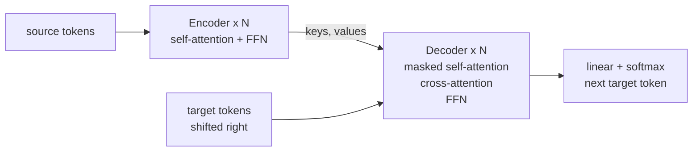

## 3.2 Why GPT-2 uses a decoder-only architecture
GPT-2 is a language model: it models $p(x) = \prod_t p(x_t \mid x_{<t})$ over plain text. There is no separate source
sequence to encode, so the encoder and the cross-attention sublayer have nothing to do. What remains is the decoder with
masked self-attention. A prompt is simply the first tokens of the same sequence: the model reads it with the same causal
self-attention it uses to generate, which makes a single stack both the "encoder" of the prompt and the generator of the
continuation. This is simpler, spends all parameters on one stack, and can be trained on raw unlabeled text. For my
application, prompted story generation, the prompt is the beginning of a story.

## 3.3 Masked self-attention, unmasked self-attention, and cross-attention
| Type | Queries from | Keys and values from | Mask | Used in | In my code |
|---|---|---|---|---|---|
| Masked (causal) self-attention | the sequence | the same sequence | position $i$ sees only $j \le i$ | decoder; GPT-2 | `CausalSelfAttention(causal=True)` |
| Unmasked self-attention | the sequence | the same sequence | none | encoder | `CausalSelfAttention(causal=False)` (for demonstration) |
| Encoder-decoder cross-attention | decoder states | encoder output | none (apart from padding) | translation decoder | not needed; there is no encoder |

For $T = 4$ the self-attention masks (1 = allowed) are

```
masked:   1 0 0 0        unmasked:   1 1 1 1
          1 1 0 0                    1 1 1 1
          1 1 1 0                    1 1 1 1
          1 1 1 1                    1 1 1 1
```

while in cross-attention the score matrix is $T_{target} \times T_{source}$ because queries and keys come from different
sequences. The figures below use the trained model: the left column is the real causal attention of three heads; the
right column runs the same trained weights with the mask removed (an intervention, since the model was never trained
that way), showing what the mask forbids. The notebook also prints the average share of attention that would go to future
tokens without the mask.

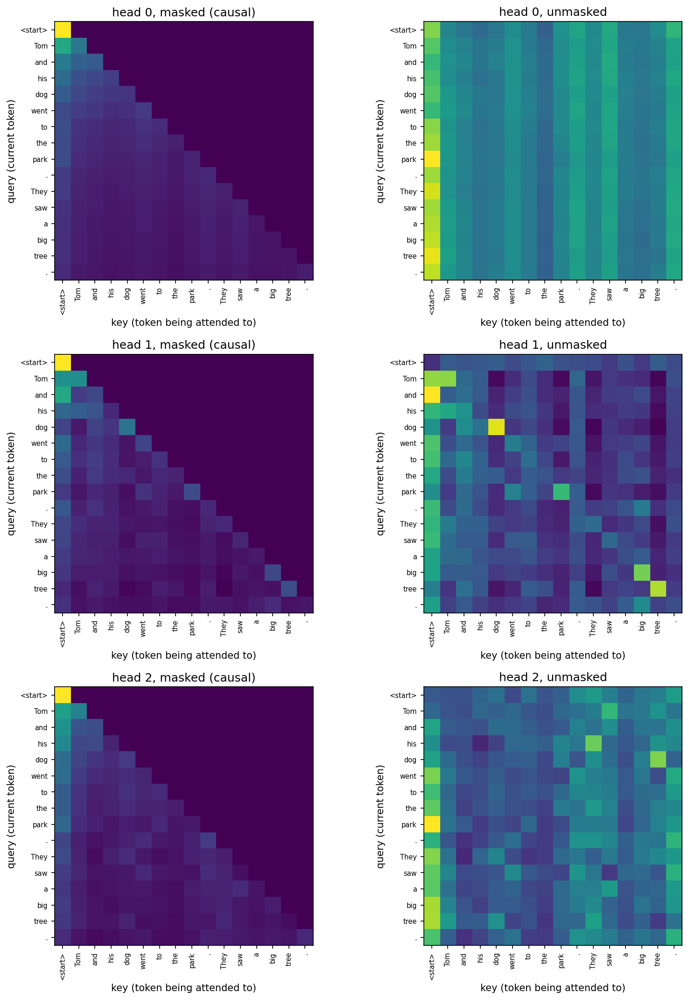
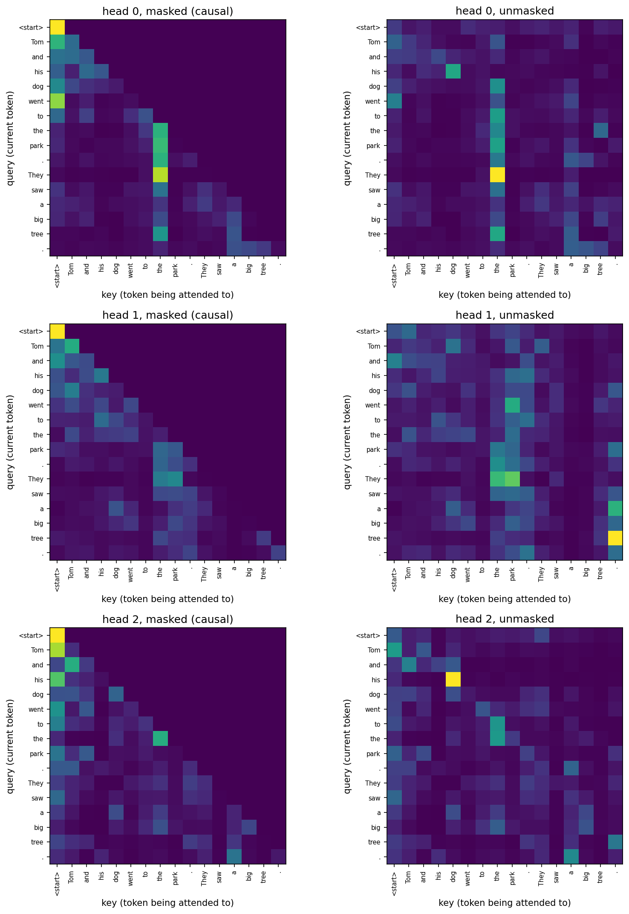

## 3.4 How causal masking enables autoregressive generation
Applying the chain rule, a language model needs the conditional $p(x_t \mid x_{<t})$ at every position. The causal mask
guarantees that the output at position $t$ depends only on tokens $\le t$. Therefore:

- **Training** needs one forward pass per sequence: the output at every position is trained to predict the next token,
  so a window of $T$ tokens provides $T$ training examples at once (targets are the inputs shifted by one). Without the
  mask the model could read the answer from the input.
- **Generation** repeats: run the model, take the logits of the **last** position, choose a token, append it, and
  continue, cropping the context to the last 256 tokens when it grows too long.

The mask is applied by setting the scores of forbidden positions to $-\infty$ before the softmax, so they get weight
$e^{-\infty} = 0$ and the remaining weights renormalize. Setting them to 0 would not work, because a score of 0 still
receives positive weight. I verified the property directly: changing the tokens at positions $\ge 8$ leaves the logits of
positions $< 8$ unchanged for the causal model (tests `test_causal_no_future_leak` and `test_gpt_causality`), while the
unmasked variant does leak. Generation without a key-value cache recomputes the whole context at each step, which is
quadratic in the context length per generated token; adding a KV cache is a natural extension.

## 3.5 Main differences between the original Transformer and GPT-2
| Aspect | Original Transformer (2017) | GPT-2 | My implementation |
|---|---|---|---|
| Architecture | encoder-decoder | decoder-only | decoder-only |
| Positions | fixed sinusoidal | learned absolute | learned absolute (256) |
| Normalization placement | post-LN: $\mathrm{LN}(x + \mathrm{Sublayer}(x))$ | pre-LN: $x + \mathrm{Sublayer}(\mathrm{LN}(x))$, plus an extra final LN | pre-LN plus final LN (post-LN switchable, Section 6) |
| Activation in the FFN | ReLU | GELU | GELU (tanh approximation) |
| Embedding scaling | embeddings multiplied by $\sqrt{d_{model}}$ | none | none |
| Embedding and output weights | shared | shared | shared (tied) |
| Initialization | not a focus of the paper | N(0, 0.02), with residual projections scaled with depth | N(0, 0.02); attention output and FFN second projections use standard deviation $0.02/\sqrt{2N}$ |
| Tokenization | BPE / word-piece, about 32k to 37k | byte-level BPE, 50,257 | byte-level BPE, 4,096 |
| Context length | task dependent | 1,024 | 256 |
| Size | base: 6+6 layers, $d$=512, 8 heads | smallest: 12 layers, $d$=768, 12 heads | 6 layers, $d$=384, 6 heads |
| Optimization | Adam, inverse-square-root warm-up, label smoothing | Adam variants | AdamW, linear warm-up then cosine decay |

---

# Part C: Implementation

## 4.1 Tokenizer and data pipeline
**Tokenizer.** A byte-level BPE tokenizer starts from the 256 possible bytes (so any text can be encoded, with no unknown
tokens) and repeatedly merges the most frequent adjacent pair, until the vocabulary has 4,096 entries (about 3,840
merges). I trained it on a ~200 MB sample of TinyStories. The special token `<|endoftext|>` is appended to every story and
doubles as a start-of-story marker when generating. A small vocabulary keeps the embedding table small (4096 × 384 = 1.6M
parameters, 13% of the model) and suits the simple vocabulary of TinyStories. Round-trip encoding is exact, and a test
checks it, including non-ASCII text. Shakespeare compresses worse (about 2.5 characters per token) because the tokenizer
was trained on children's stories.

**Embeddings.** The token embedding is a learnable table of shape $(V, C)$; looking up row $i$ gives the vector for token
$i$. A second table $(T_{max}, C)$ holds positions, and the two are added: `wte(idx) + wpe(arange(T))`, with the position
table broadcast across the batch.

**Data.** Text is encoded once into a flat `uint16` array stored on disk (2 bytes per token; IDs are below 65,536) and
memory-mapped during training. `get_batch` draws random start positions $i$ and returns the input window
`data[i : i+T]` and the target window `data[i+1 : i+T+1]`, so the target at each position is the next token.

## 4.2 Architecture diagram
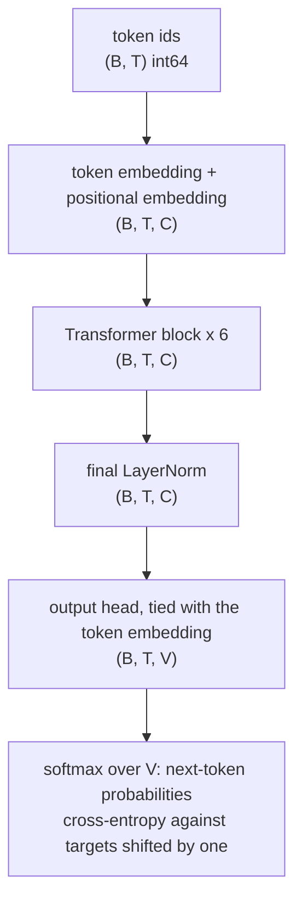
Here $B$ is the batch size, $T$ the number of tokens (at most 256), $C = 384$, and $V = 4096$.

One pre-LN Transformer block (the block keeps the shape $(B, T, C)$):
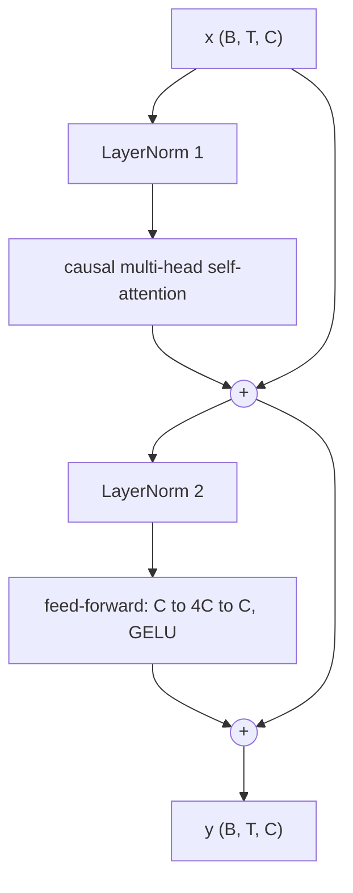

## 4.3 Tensor shapes through the attention mechanism
With $B$ sequences, $T$ tokens, $h = 6$ heads of size $d = 64$ and $C = hd = 384$:

| Step | Code | Shape |
|---|---|---|
| input after LayerNorm | `ln1(x)` | $(B, T, C)$ |
| query, key, value projections | `q_proj(h)`, `k_proj(h)`, `v_proj(h)` | $(B, T, C)$ each |
| split into heads | `.view(B, T, h, d).transpose(1, 2)` | $(B, h, T, d)$ |
| scores | `q @ k.transpose(-2, -1) / sqrt(d)` | $(B, h, T, T)$ |
| causal mask | `masked_fill(~mask[:, :, :T, :T], -inf)` | $(B, h, T, T)$ |
| attention weights | `softmax(dim=-1)` | $(B, h, T, T)$, rows sum to 1 |
| weighted values | `att @ v` | $(B, h, T, d)$ |
| merge heads | `.transpose(1, 2).contiguous().view(B, T, C)` | $(B, T, C)$ |
| output projection | `out_proj` | $(B, T, C)$ |

For $B = 64$, $T = 256$ the score tensor has $64 \cdot 6 \cdot 256 \cdot 256 \approx 25$M elements per layer. The
`@` operator multiplies the last two dimensions and treats the earlier ones as batch dimensions, which is why moving the
head dimension next to the batch dimension lets all six heads run in parallel in a single multiplication. `.contiguous()`
is needed before `.view` because `transpose` only changes how memory is read.

## 4.4 Relating the code to the paper
| Component | Code | Paper |
|---|---|---|
| Token and positional embeddings | `Embeddings` | Sections 3.4 and 3.5 (learned positions, no scaling) |
| Scaled dot-product attention | `CausalSelfAttention.forward` | Section 3.2.1, Equation 1 |
| Multi-head attention | `_split_heads`, `out_proj` | Section 3.2.2 |
| Decoder masking | `register_buffer("mask")`, `masked_fill(-inf)` | Section 3.2.3 |
| Position-wise FFN | `FeedForward` | Section 3.3 (GELU instead of ReLU) |
| Layer normalization | `LayerNorm` | Ba et al. (2016), used in Section 3.1 |
| Residual connections | `Block` | Section 3.1 |
| Output layer | tied `lm_head` plus cross-entropy | Section 3.4 |

I checked correctness with 41 unit tests, including: output shapes; no information flow from future tokens;
attention equal to PyTorch's `scaled_dot_product_attention` (as a reference only); my LayerNorm equal to `nn.LayerNorm`
with random scale and shift; attention rows summing to 1 with nothing above the diagonal; the parameter counts of every
component; weight tying; initial loss close to $\ln V = 8.318$ for independent targets; and the ability to overfit a
single batch. The main run's recorded step-0 validation loss is 8.397.

## 4.5 Training pipeline
The loss is the cross-entropy over all $B \cdot T$ positions between the logits $(B, T, V)$ and the shifted targets.

| Setting (main run) | Value |
|---|---|
| Batch | 64 sequences × 256 tokens × 2 gradient-accumulation steps = 32,768 tokens per step |
| Steps | 8,000 (262M tokens, about 21 tokens per parameter) |
| Optimizer | AdamW, betas (0.9, 0.95), weight decay 0.1 on matrices and embeddings only |
| Learning rate | warm-up over 300 steps to $10^{-3}$, then cosine decay to $10^{-4}$ |
| Gradient clipping | global norm 1.0 |
| Precision | fp16 autocast with a gradient scaler |
| Evaluation | every 500 steps on 50 fixed random batches (same batches every time) |
| Dropout | 0 |

The schedule is $\mathrm{lr}(t) = \mathrm{lr}_{max}(t+1)/W$ for $t < W$, then
$\mathrm{lr}_{min} + \tfrac12\bigl(1+\cos(\pi\,\tfrac{t-W}{T-W})\bigr)(\mathrm{lr}_{max}-\mathrm{lr}_{min})$. Warm-up matters
because Adam's statistics are noisy at the start. Weight decay is not applied to biases and LayerNorm parameters.
Gradient accumulation divides each micro-batch loss by the number of accumulation steps so the summed gradient is an
average. The gradient scaler multiplies the loss before the backward pass so that small fp16 gradients do not underflow,
unscales before clipping, and skips a step whose gradients contain infinities or NaNs. The resumable checkpoint (weights,
optimizer and scaler state, step, best validation loss, and configs) is written atomically, and training resumes from it
automatically; a separate best-validation checkpoint is also kept. The development order was: unit tests, overfit one
batch, a short run on Shakespeare, then the main run.

## 4.6 Text generation
`GPT.generate` implements the loop of Section 3.4. With `temperature = 0` it takes the argmax (greedy decoding).
Otherwise it divides the logits by the temperature $\tau$ before the softmax and samples with `torch.multinomial`:
$p_i \propto \exp(z_i/\tau)$. A low temperature sharpens the distribution (it approaches greedy as $\tau \to 0$), a high
temperature flattens it toward uniform. Generation stops at `<|endoftext|>` or after a maximum number of new tokens.

---

# Part D: Experiments and findings

## 5.1 Configurations and results
| Run | Data | Steps × tokens per step | Tokens seen | Final train loss | Final val loss |
|---|---|---|---|---|---|
| `shakespeare_debug` (dropout 0.2) | Tiny Shakespeare | 1,500 × 8,192 | 12.3M (about 30 epochs) | 2.102 | 3.671 (best 3.630 at step 1,200) |
| `tinystories_main` | TinyStories | 8,000 × 32,768 | 262.1M | 1.363 | **1.372** |
| `heads_1` | TinyStories | 1,500 × 32,768 | 49.2M | 1.714 | 1.720 |
| `heads_2` | TinyStories | 1,500 × 32,768 | 49.2M | 1.706 | 1.712 |
| `heads_6` (seed 1337) | TinyStories | 1,500 × 32,768 | 49.2M | 1.697 | 1.703 |
| `heads_6_seed2` (seed 1338) | TinyStories | 1,500 × 32,768 | 49.2M | 1.692 | 1.698 |
| `heads_12` | TinyStories | 1,500 × 32,768 | 49.2M | 1.698 | 1.705 |
| `postln_lr1e-3` | TinyStories | 1,500 × 32,768 | 49.2M | 5.879 | 5.888 |
| `postln_lr3e-4` | TinyStories | 1,500 × 32,768 | 49.2M | 2.448 | 2.458 |
| `preln_lr3e-4` | TinyStories | 1,500 × 32,768 | 49.2M | 1.968 | 1.973 |

All losses are cross-entropy in nats per token. Logs, configs, and figures for each run are in `results/<run>/`. Unless
noted, every model has 12,318,720 parameters.

## 5.2 Shakespeare debug run: overfitting
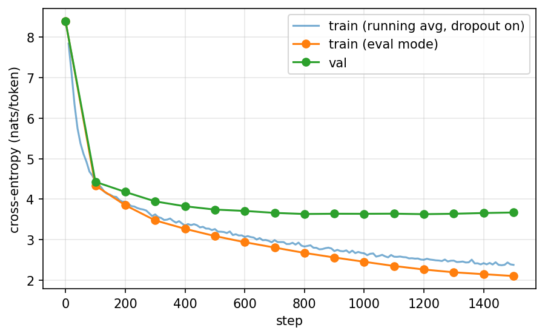

Validation loss fell until step 800 and then flattened near 3.63 (lowest value 3.630 at step 1,200), and then rose to
3.671 while the training loss (evaluated without dropout) kept falling to 2.10, a final gap of about 1.57 nats. This is
overfitting: 1,500 steps pass over the 405k-token training set about 30 times, and a 12M-parameter model can memorize it
even with dropout 0.2. I therefore use the checkpoint with the lowest validation loss (`best.pt`), not the last one, for
generation. The run also served its purpose as a pipeline test: at step 0 the train and validation losses were 8.396 and
8.390, close to $\ln 4096 = 8.318$; late logged gradient norms were about 0.76-0.83; and all recorded values remained
finite under fp16. The two training curves differ because the running average is computed with dropout active and the
evaluation curve without it.

## 5.3 TinyStories main run
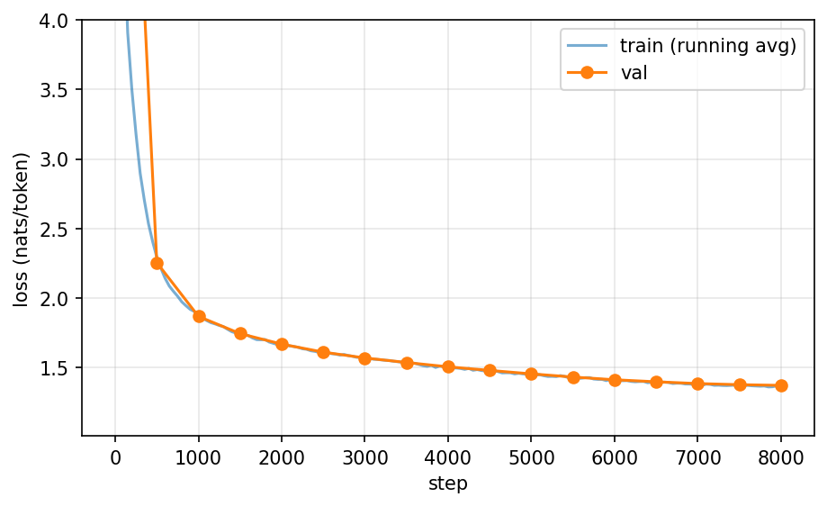

| Step | 500 | 1,000 | 2,000 | 3,000 | 4,000 | 5,000 | 6,000 | 7,000 | 8,000 |
|---|---|---|---|---|---|---|---|---|---|
| Validation loss | 2.255 | 1.868 | 1.669 | 1.569 | 1.505 | 1.455 | 1.412 | 1.385 | 1.372 |

The final validation loss is 1.372 (perplexity $e^{1.372} \approx 3.9$ per token), only 0.009 above the training loss, so
there is no sign of the widening overfitting gap seen on Shakespeare. The loss was still improving slowly at the end;
training longer may therefore help, although this run does not test that counterfactual. Training was stable: late
gradient norms were near 0.4, all logged values were finite, and throughput settled near 68-69k tokens per second after
a slower start (see Section 5.7). The run used about 21 training tokens per parameter, close to the compute-balanced rule
of thumb from Hoffmann et al. (2022).

A greedy continuation of the prompt "The little dog was sad because":

> The little dog was sad because he had no friends. He walked around the park, looking for someone to play with. He saw a big tree and thought, "Maybe I can find a friend there."
> The little dog walked to the tree and saw a little girl. She was playing with a ball. The little dog walked up to her and said, "Hi, I am a dog. Do you want to play with me?" The little girl smiled and said, "Yes, I am Lily. I am a dog, but I have no friends."
> The little dog was happy to have a new friend. They played together all day. The little dog was not sad anymore. He had a new friend, and they had lots of fun.

and a sample at temperature 0.7 from the prompt "Once upon a time" began: "Once upon a time, there was a kind sailor named Tom. Tom had a big boat. He liked to sail on the sea. One day, Tom saw a little fish. The little fish was sad. ..." and
ended with Tom and a bird sailing together as best friends. Both are grammatical, keep their characters, use correct dialogue punctuation, and
end where a story should end. The failures are about logic and consistency: in the greedy story the girl says "I am a
dog", and another sample turns a bird into a fairy and, a few sentences later, says the bird stayed with her. Both
temperature-0.7 stories I inspected contain a "something unexpected happened, an animal turned into something magical,
they became best friends" pattern, which I take to be a motif absorbed from the dataset (I did not test this). The model has learned the form of simple stories
more reliably than their logic.

## 5.4 Effect of temperature
For 50 TinyStories validation-story prefixes of 16 tokens, I generated 4 samples per prompt at each
temperature (greedy: one) with up to 200 new tokens, and measured with whitespace-separated words:

- *Repetition* (`rep3`): the fraction of word trigrams in a sample that already appeared earlier in the same sample.
- *Diversity* (`distinct-2`): unique word bigrams divided by total bigrams, pooled over the 4 samples of one prompt
  (not defined for greedy, which is deterministic). This is the distinct-n measure of Li et al. (2016).
- *% ended*: the share of samples that produced the end-of-story token within 200 new tokens.

| Temperature | Repeated trigrams | Distinct-2 across samples | % ended | Mean words |
|---|---|---|---|---|
| 0 (greedy) | 0.074 | n/a | 66% | 133.7 |
| 0.3 | 0.070 | 0.674 | 64% | 135.6 |
| 0.7 | 0.039 | 0.777 | 60% | 136.7 |
| 1.0 | 0.018 | 0.861 | 59% | 134.4 |
| 1.5 | 0.001 | 0.986 | 41% | 123.3 |

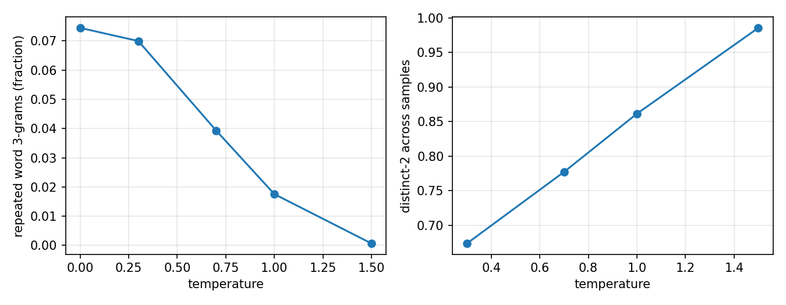

Repetition falls and diversity rises monotonically with temperature, as expected, but the metrics must be read together
with coherence: `distinct-2` alone would favor the highest temperature, where the text is partly incoherent, so a quality
judgement from reading samples is essential (`results/analysis/report_samples.txt`). The `% ended` column carries
additional information: low temperatures finish their stories (66% for greedy), while at 1.5 only 41% do, consistent with
the qualitative degradation in `report_samples.txt`. Three caveats apply: a sample that ends early is shorter and has
fewer chances to repeat; there are 200 texts per non-greedy setting but only 50 greedy continuations; and the metric counts
repeated word trigrams, not repeated meaning.

## 5.5 Effect of prompt length and context
**Loss by position (and why it is not enough).** My first context experiment measured the next-token loss at each
position of 500 validation stories (`[start] + story[:200]`). The curve is not decreasing: it is 2.21 with a one-token
context, falls to 0.65 at two tokens, and then varies substantially (about 0.77-1.76 from position 4 onward). This is
because story openings are formulaic ("Once upon a time", "One day"), so early tokens can be easy to predict regardless
of context length: the curve mixes how much context the model has with how predictable each target position is.

**Fixed-target experiment.** To isolate the effect of context I fixed the target tokens (positions 128, 136, ..., 192 of
500 stories, 4,500 tokens) and gave the model only the previous $k$ tokens:

| Context $k$ | 1 | 2 | 4 | 8 | 16 | 32 | 64 | 127 | full prefix |
|---|---|---|---|---|---|---|---|---|---|
| Loss | 3.950 | 3.306 | 2.796 | 2.364 | 2.027 | 1.742 | 1.536 | 1.429 | 1.411 |
| Share of the total gain | 0% | 25% | 45% | 62% | 76% | 87% | 95% | 99% | 100% |

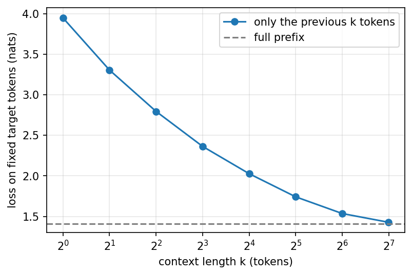

The loss falls steadily with more context, with strongly diminishing returns: each doubling of $k$ helps less
(−0.64, −0.51, −0.43, −0.34, −0.29, −0.21, −0.11), the first 16-32 tokens give 76-87% of the total improvement, and 127
tokens are within 0.02 nats of the full prefix. Perplexity falls from about 52 at one token of context to about 4.1. A
caveat: with learned absolute positions, a truncated window is re-numbered from position 0 and mid-story text is presented
as if it were a story opening, so the high loss at small $k$ combines less information with an out-of-distribution
input. The monotonic ordering is clear in this experiment, but the absolute small-$k$ values should be interpreted with
that confound in mind. The 1.411 is also not comparable to the validation loss, which averages all positions.

**Effect on generation.** I generated continuations at temperature 0.7 from the first 1, 4, 16 or 64 tokens of the same
validation stories:

| Prompt tokens | Repeated trigrams | Distinct-2 | % ended | Mean words |
|---|---|---|---|---|
| 1 | 0.036 | 0.795 | 57% | 142.2 |
| 4 | 0.035 | 0.798 | 63% | 138.9 |
| 16 | 0.039 | 0.777 | 60% | 136.7 |
| 64 | 0.031 | 0.779 | 69% | 114.4 |

Repetition and diversity are small and non-monotonic, so this single run does not establish a trend for either metric.
The clearest observed difference is length and closure: 64-token prompts produced shorter continuations and more endings.
These aggregate metrics do not directly measure consistency with established characters or settings; the
loss-versus-context curve measures predictive benefit more directly, and `prompt_length_samples.txt` contains qualitative
continuations for the same stories at each prompt length.

## 5.6 Effect of the number of attention heads
Four models with 1, 2, 6 and 12 heads were trained for 1,500 steps (49M tokens) with identical settings. Because
`q_proj`, `k_proj`, `v_proj` and `out_proj` are all $384 \times 384$ regardless of the number of heads, all runs have
exactly 12,318,720 parameters: only the partition of the 384 features into heads differs. I also trained the 6-head model
with a second seed to get one estimate of seed-to-seed variation.

| Heads | Head size | Validation loss | Gap to 6 heads (seed 1337) | Steady throughput |
|---|---|---|---|---|
| 1 | 384 | 1.720 | +0.017 | 89.7k tok/s |
| 2 | 192 | 1.712 | +0.009 | 81.9k tok/s |
| 6 | 64 | 1.703 (seed 2: 1.698) | n/a | 69.9k tok/s (seed 2: 71.6k) |
| 12 | 32 | 1.705 | +0.002 | 59.0k tok/s |

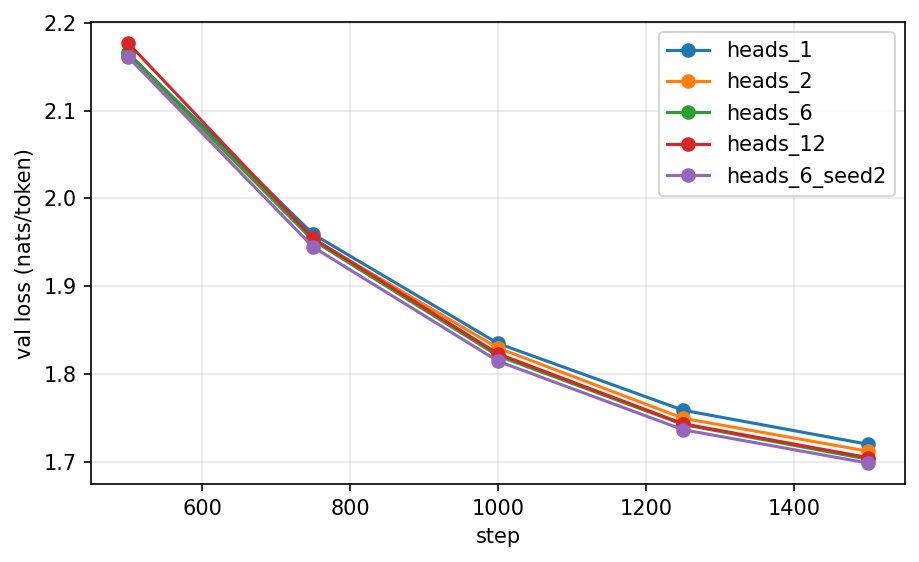

The two 6-head runs differ by 0.004. The 1-head deficit relative to those runs is 0.017-0.021 nats (about 2% in
perplexity), several times that observed seed difference; the 2-head deficit is 0.009-0.014; and the 6-versus-12-head gap
is only 0.002 for seed 1337. This is evidence that one head is worse in this budget, but with only one seed for the other
head counts it is not a statistical significance test. The result fits the intuition of Section 2.4: one head gives each
layer only one attention distribution per token, whereas very many heads reduce the dimensionality available to each
distribution. The original paper's Table 3 also found one head worse than its best setting and a decline with too many
heads on translation; the tasks differ, so this is only a qualitative comparison.

Throughput moved the other way: using steady-state medians from the seed-1337 logs, one head is about 28% faster than six
and twelve heads about 16% slower. A plausible explanation is that my implementation materializes a $(B, h, T, T)$ score
tensor, so the memory traffic of masking, softmax, and dropout grows with the number of heads while the leading-order
matrix-multiplication FLOPs stay constant; I did not profile kernels or memory traffic. Equal-step and equal-time
comparisons therefore differ, and I did not run a time-matched ablation. **Limitations:** one seed per head count (two for
six heads), a short training budget, and small absolute differences (about 1% of the loss), so conclusions might change
with longer training.

## 5.7 Limitations, challenges, and lessons learned
**Model limitations.** The model writes locally coherent stories but loses track of who is who, drifts in plot logic, and
tends to reuse dataset motifs. It has 256 tokens of context and was trained for about an hour.

**Experimental limitations.** Ablations are short and mostly single-seed; text-quality metrics are word-based
and count repetition and diversity but not coherence (no human or model-based evaluation was done); and the
context experiment has the position-renumbering confound described in Section 5.5.

**Implementation challenges and how I handled them.**
- *A misleading initial-loss test.* With tied embeddings, a token's own embedding already points toward itself, so the
  initial loss is low if the targets equal the inputs. I measure the initial loss against independent targets
  (about 8.4, near $\ln V$) and treat that value as a sanity anchor.
- *Mixed precision.* fp16 gradients can underflow; the gradient scaler and unscaling before clipping handled this and no
  run produced NaNs.
- *Throughput measurement.* Some logs contain a long ramp: for example, the seed-1337 six-head run starts at 10.7k
  tokens/s and reaches about 69-70k after step 1,000, whereas its second-seed run starts near full speed. This run-order
  effect is consistent with cache warm-up but was not profiled, so I used steady-state medians for throughput comparisons.
- *A flawed first experiment.* The loss-by-position curve confounds predictability with context (Section 5.5), so I
  redesigned the context experiment around fixed target tokens. Short generations also hid repetition, so I repeated the
  temperature experiment with longer samples and more prompts.
- *Reproducibility.* The Kaggle notebooks clone the repository from GitHub, so every config file and script needed by a
  remote run must be committed before that run starts.

**Lessons learned.** (1) Write tests for the properties the architecture promises (causality, shapes, equality with
reference implementations) before training anything. (2) Check simple anchors (initial loss $\approx \ln V$, overfitting one
batch, gradient norms) before long runs. (3) Measure seed-to-seed variation before interpreting small differences.
(4) Pre-LayerNorm was substantially more forgiving in the tested settings. (5) Design experiments so that what you vary is the
only thing that changes, and say honestly when a metric does not measure what you want. (6) Small models can learn the
form of language long before its logic.

**With more time.** A KV cache for faster generation; trained-model attention analysis beyond the heatmaps; comparisons of
learned, sinusoidal, and rotary positions; multiple seeds for every ablation; a longer main run; and a coherence metric.

---

# 6. Additional experiment: pre-LayerNorm versus post-LayerNorm
GPT-2 moved layer normalization from after each sublayer (original) to before it (pre-LN). With the `pre_ln` switch, I
trained the original post-LN block, $x \leftarrow \mathrm{LN}(x + \mathrm{Sublayer}(x))$, without GPT-2's extra final LayerNorm
(the post-LN model has 768 fewer parameters), with the same data and budget as the head-count runs. Because a lower
learning rate with a longer warm-up is the usual remedy for post-LN, I ran a 2×2 comparison:

| | lr 1e-3, warm-up 100 | lr 3e-4, warm-up 300 |
|---|---|---|
| pre-LN | **1.703** (seed 2: 1.698) | 1.973 |
| post-LN | 5.888 (stalled) | 2.458 |

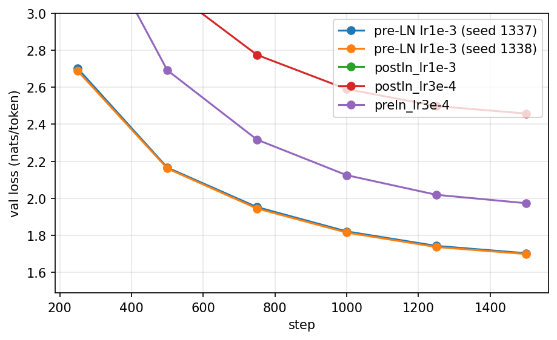

- **The post-LN run stalled at the learning rate where pre-LN worked well.** Its logged training loss reached 5.90 by
  step 100 and stayed near 5.89 for the remaining 1,400 steps. It was a finite plateau rather than a numerical divergence:
  recorded gradient norms were 0.12-0.33 and all logged losses were finite. The logs do not establish what distribution
  the stalled model learned.
- **At the gentler setting post-LN trains but is much worse:** 2.458 versus 1.973 for pre-LN, a gap of 0.485 nats
  (about 1.6× in perplexity).
- **Pre-LN trains at both tested settings** and reaches a lower loss with the higher learning rate in this fixed 1,500-step
  budget. Across these settings it is less sensitive than post-LN.
- The step-0 losses are nearly identical (8.46 versus 8.40), so the gap is a matter of optimization dynamics, not of
  initialization.

This is consistent with analyses showing that post-LN Transformers can be harder to optimize and more sensitive to
warm-up (Xiong et al., 2020). **Caveats:** one seed per cell, 1,500 steps, the learning rate and warm-up were changed
together, and I did not tune post-LN further, so a better-tuned post-LN run could close part of the gap.

---

# 7. Reproducibility
```bash
pip install -r requirements.txt
python -m pytest -q                                           # unit tests
RAW_DIR=data/raw OUT_DIR=data python -m src.prepare_data      # download and encode the data (about 2.2 GB)
python -m src.train --config configs/shakespeare.yaml --set train.data_dir=data train.out_dir=runs
python -m src.train --config configs/tinystories_main.yaml --set train.data_dir=data train.out_dir=runs
python -m src.generate --ckpt models/tinystories_main_best.pt --prompt "Once upon a time" --temperature 0.7 --n 3
python -m src.experiments --ckpt models/tinystories_main_best.pt --data_dir data --out results/analysis --n_prompts 50 --n_samples 4 --max_new 200
```
The notebook `notebooks/demo.ipynb` runs the tests, loads the model, generates text, shows the results and attention
maps, and trains a small model from scratch, without any local setup (it also opens directly in Colab or Kaggle).

# References
1. Vaswani, A., et al. (2017). Attention Is All You Need. *NeurIPS 30*. https://arxiv.org/abs/1706.03762
2. Radford, A., et al. (2019). Language Models are Unsupervised Multitask Learners (GPT-2). OpenAI.
3. Eldan, R., and Li, Y. (2023). TinyStories: How Small Can Language Models Be and Still Speak Coherent English? https://arxiv.org/abs/2305.07759
4. Ba, J. L., Kiros, J. R., and Hinton, G. E. (2016). Layer Normalization. https://arxiv.org/abs/1607.06450
5. He, K., et al. (2016). Deep Residual Learning for Image Recognition. *CVPR*.
6. Hendrycks, D., and Gimpel, K. (2016). Gaussian Error Linear Units (GELUs). https://arxiv.org/abs/1606.08415
7. Loshchilov, I., and Hutter, F. (2019). Decoupled Weight Decay Regularization. *ICLR*.
8. Sennrich, R., Haddow, B., and Birch, A. (2016). Neural Machine Translation of Rare Words with Subword Units. *ACL*.
9. Xiong, R., et al. (2020). On Layer Normalization in the Transformer Architecture. *ICML*.
10. Hoffmann, J., et al. (2022). Training Compute-Optimal Large Language Models. https://arxiv.org/abs/2203.15556
11. Li, J., et al. (2016). A Diversity-Promoting Objective Function for Neural Conversation Models. *NAACL*.
12. Micikevicius, P., et al. (2018). Mixed Precision Training. *ICLR*.
13. Karpathy, A. (2022). Let's build GPT: from scratch, in code, spelled out. https://www.youtube.com/watch?v=kCc8FmEb1nY
14. Alammar, J. (2018). The Illustrated Transformer. https://jalammar.github.io/illustrated-transformer/
